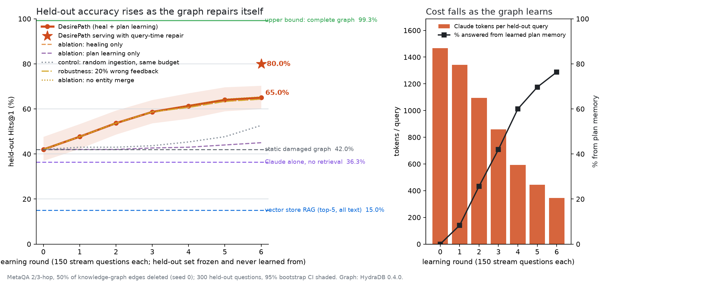

# DesirePath

**A knowledge graph on HydraDB that repairs itself where users ask.**
HydraDB Hackathon, Track 1: the self-improving graph.

**Live replay (interactive, free-hosted):** https://rajputdivyanshu81.github.io/HydraHack/ . It replays real recorded runs against HydraDB; run the full system live with `docker compose up` (see below).



<!-- RESULTS:START -->
| System | Held-out Hits@1 | Seen topics | Never-seen topics | Claude tokens / query |
|---|---|---|---|---|
| Vector-store RAG: all 18k passages, top-5, Claude answers | 15.0% | 15.3% | 14.7% | 1867 |
| Claude alone, no retrieval | 36.3% | 40.7% | 32.0% | 689 |
| Damaged graph, no learning | 42.0% | 35.3% | 48.7% | 1467 |
| Random ingestion, same reading budget (control) | 52.7% | 49.3% | 56.0% | 685 |
| Healing only | 64.3% | 77.3% | 51.3% | 1467 |
| Plan learning only | 45.0% | 40.0% | 50.0% | 727 |
| All mechanisms except entity merge | 65.3% | 78.0% | 52.7% | 344 |
| DesirePath with 20% wrong feedback | 64.3% | 77.3% | 51.3% | 461 |
| **DesirePath** (all four mechanisms) | 65.0% | 77.3% | 52.7% | 344 |
| Upper bound: complete graph | 99.3% | 99.3% | 99.3% | 1467 |
| **DesirePath, serving with query-time repair** | 80.0% | 78.7% | 81.3% | 4283 |

DesirePath went from 42.0% to 65.0% held-out Hits@1 over 6 rounds, while Claude tokens per query fell from 1467 to 344.
Graph edits: 33,360 edges healed from 3,286 passages; 56 plans learned across 309 question wordings.
Entity resolution: 436 normalised links, 58 alias merges, 1829 new entities, 1182 names dropped.
Path compression: 24 hot traversals compressed into 90 SHORTCUT edges; 3 invalidated by healing.
Under load: 32 concurrent readers plus a live writer: 120.1 queries/s, p50 35.3 ms, p95 620.5 ms, 0 errors.
SHORTCUT reads: p50 4.91 ms vs 4.83 ms for the 2.48-hop traversal they replace (0.98x).
<!-- RESULTS:END -->

## The problem

Every company's knowledge graph is incomplete. For example:

- A service map is missing dependencies.
- A ticket graph is missing links to the incidents that caused it.
- A CRM is missing who reports to whom.

Vector search can't fix this. It finds passages that look like the question, but it can't follow a chain of relationships (service → dependency → past incident → fix) when half the chain lives in text no one has turned into edges.

## What DesirePath does

It answers questions by traversing a HydraDB graph. Each answer then teaches the graph something. It uses all four Track 1 mechanisms, and each one is a real graph edit:

1. **Gap-driven ingestion.** Traversal reports exactly where it got stuck: the nodes that should have continued along the next relation but have no such edge. DesirePath reads the text about those entities, extracts the missing facts, and writes them into HydraDB as typed edges (`src: 'text'`). The graph is repaired only where people ask, like a desire path worn into a lawn.
2. **Edge reweighting.** Plan memory lives in the graph itself: `(:Template)-[:USES {cost, wins, tries}]->(:Plan)`. When feedback arrives, `algo.SPpaths` finds the relation paths that actually connect the question's entity to the right answers. The winning plan's `USES` edge gets cheaper and the losing plan's gets more expensive. Once a plan has evidence behind it (at least 2 wins and a 60% win rate), the LLM planner is skipped, so accuracy goes up and tokens per query go down.
3. **Entity merge.** Names extracted from text are resolved before they become edges:
   - first by exact match;
   - then accent-, punctuation- and spacing-insensitive ("Robert DeNiro" → "Robert De Niro");
   - then by first-and-last-name alias, when the match is unique ("Samuel Jackson" → "Samuel L. Jackson");
   - genre synonyms map to the knowledge graph's genres.

   People who aren't in the graph become new nodes and can still bridge paths. Every merge and new node is logged.
4. **Path compression.** When a (topic, plan) pair keeps producing confirmed answers, its multi-hop result is written as direct `SHORTCUT` edges, so the next question reads one hop instead of three. Invalidation is exact: a compressed result can only change if a new edge touches a node the traversal reached. DesirePath records that node set, and healing deletes the shortcut the moment it writes such an edge.

**Serving mode: query-time repair.** On a topic the graph has never been asked about, traversal can hit a gap on first contact. DesirePath reads the text, heals, and answers again within the same request. It uses no feedback and no gold answers, only text. This mode is reported separately from the learning curve.

Every edit goes to an append-only log with its cause (`results/*.edits.jsonl`): `ingest`, `reweight`, `merge`, `new_entity`, `compress`, `decompress`. The demo shows that log live.

## What we found

- **Healing drives accuracy; plan learning drives cost.** Healing only lifts held-out Hits@1 by about 22 points. Plan learning only adds about 3 points, but with both, DesirePath matches healing-only accuracy at roughly a quarter of the Claude tokens per query.
- **Planning is solved; the graph's gaps are the problem.** On the complete graph, the same planner scores 99.3%. Every point between the damaged graph's 42.0% and that 99.3% is missing edges.
- **The graph improves where people ask.** Learning from the stream lifts seen topics most: 35.3% → 77.3% held-out Hits@1. Never-seen topics barely move (48.7% → 52.7%), because nobody has asked about them yet.
- **Query-time repair closes that gap: 80.0% held-out overall, and never-seen topics go from 52.7% to 81.3%.** When traversal hits a gap at serving time, DesirePath reads the text about the stuck entities, heals and answers again. It uses text only, with no feedback and no gold answers. 58% of held-out questions triggered a repair. The cost is latency and tokens on first contact: p50 115 ms, and 4,283 Claude tokens per query on average across the set.
- **Targeting matters, not just reading more.** Random ingestion with the same reading budget reaches 52.7%, against 65.0% for gap-driven healing.
- **Robust to bad feedback.** With 20% of feedback replaced by wrong answers, DesirePath still reaches 64.3% (vs 65.0%).
- **Entity merge links more names but doesn't change accuracy here.** Without it, held-out Hits@1 is 65.3%; with it, 65.0%, a difference well within noise. The questions' answers are almost always names already in the knowledge graph, so the extra links from merging rarely sit on an answer path. We report it as neutral.
- **Path compression gives no measurable speedup here.** HydraDB already serves a 2–3 hop traversal in about 10 ms, so the HTTP round trip dominates. We keep compression because it's correct and exactly invalidated, but we don't claim a latency win.
- **Silent failures were caught and fixed.** An early run silently skipped passages when an extraction call failed. Runs now retry and abort on failure, and every reported result has zero extraction errors (`healer.extract_errors` in each results file).

## Why it needs the graph

- Answers are multi-hop sets. An example: "who directed the movies starring X". The answer needs X's movies first, then each of their directors, aggregated across many paths. Retrieving passages that resemble the question doesn't produce that.
- The baselines are on the same chart. One is a vector store holding all the text (more knowledge than the damaged graph). The other is Claude alone.
- The control is fair. Random ingestion gets the same reading budget, which separates the gain from targeting the gaps from the gain of simply reading more text.

## The experiment

- **Benchmark:** MetaQA 2-hop and 3-hop over the WikiMovies knowledge graph (134k triples, 9 relations).
- **Damaged graph:** 50% of triples deleted with seed 0. The original WikiMovies articles are the repair source.
- **Questions:** a stream of 900 for learning, and a frozen set of 300 held out that the system never learns from. Half the held-out questions are about topics the stream never mentions, so you can see how much is transfer and how much is memorisation.
- **Workload:** the stream is popularity-skewed (Zipf) over 600 frequently asked topics, as real query logs are.
- **Protocol:** round 0 scores the damaged graph. Each round then learns from 150 stream questions and re-scores the frozen held-out set. Hits@1 comes with 95% bootstrap confidence intervals.
- **Ablations:** healing only, plan learning only, no entity merge, random ingestion at a matched budget, and 20% wrong feedback.
- **Path compression** doesn't change answers by design, so it's measured as latency: the load test times each live `SHORTCUT` read against the full traversal it replaces.

## Engineering on HydraDB

| What | How |
|---|---|
| Traversal | OpenCypher chains over typed edges, e.g. `(n0 {id:$t})-[:R_STARRED_ACTORS]->(n1)-[:DIRECTED_BY]->(n2)` |
| Gap detection | Prefix queries per hop; nodes reached at hop *i* with no edge along hop *i+1* |
| Plan discovery | `CALL algo.SPpaths({sourceNode, targetNode, relTypes, maxLen: 3})`, using edge types from returned paths |
| Learned costs | `SET u.cost` on `USES` edges; `algo.SPpaths` honours `weightProp: 'cost'` (verified in `scripts/spike.py`) |
| Writes | Batched `UNWIND $rows ... CREATE` (1,000 rows per batch, explicit edge ids), single writer |
| Under load | `eval/load_test.py`: 32 concurrent traversal readers while a writer streams edges |

Engine constraints we hit and designed around (HydraDB 0.4.0): batched edge creation needs labelled endpoints and an explicit edge `id`; batched `SET` values must come from the row; no `OPTIONAL MATCH` of this shape and no `UNWIND` reads over HTTP; `sum()` is integer-only; non-batched `MERGE ... SET` isn't executable.

## Run it

```powershell
mkdir config; Set-Content config\auth-token "local-development-token-32-bytes-desirepath" -NoNewline   # local DB token (>= 32 chars)
docker compose up -d                       # HydraDB 0.4.0, local storage, telemetry off
python -m venv .venv; .\.venv\Scripts\pip install httpx anthropic numpy matplotlib sentence-transformers streamlit python-dotenv
copy .env.example .env                     # add ANTHROPIC_API_KEY
.\.venv\Scripts\python -m desirepath.data  # needs data/raw (see below)
.\scripts\run_all.ps1                      # every variant, baselines, chart, load test
.\.venv\Scripts\streamlit run demo/app.py  # live demo
```

`scripts\run_all.ps1 -Offline` runs everything with no API key. It uses a rule-based planner and a regex extractor in place of Claude.

**Data sources:**
- MetaQA from the Hugging Face mirror `camazlucas/MetaQA` (original: github.com/yuyuz/MetaQA, CC licence).
- WikiMovies text from the bAbI `movieqa.tar.gz` (CC BY 3.0), fetched via the Internet Archive because the original host is offline.

Put them in `data/raw/metaqa/` and `data/raw/movieqa/`.

## The product: an incident copilot whose service graph heals itself

**Buyer:** platform and SRE leads.

**Their graph:** services → dependencies → past incidents → fixes. It's always stale, because the truth lives in postmortems, Slack threads and runbooks.

**How DesirePath fits:** every closed incident is free feedback. When the copilot's traversal dead-ends, it reads the relevant postmortems and adds the missing edges. Reliable resolution paths get cheaper to follow. The graph improves fastest around the services that page most often.

**Why it's worth paying for:**
- incident.io raised $62M (April 2025).
- ITIC (2024) reports that over 90% of mid-size and large enterprises put the cost of one hour of downtime above $300k.

**Pricing:** one HydraDB database per customer, which maps onto HydraDB's Scale tier.

## Layout

```
desirepath/  db.py (HydraDB HTTP client) · graph.py (schema, loading) · answer.py (planner, traversal, gaps)
             heal.py (gap-driven ingestion) · plans.py (plan memory + reweighting) · system.py · llm.py · data.py
eval/        run_curve.py · baselines.py · load_test.py · plot.py
demo/app.py  scripts/spike.py (engine capability checks) · scripts/run_all.ps1
```
